<!-- ============ EDIT ONLY: YOUR_USERNAME, YOUR NAME, email, links ============ -->

 

---

<table>
<tr>
<td width="36%" align="center" valign="top">

</td>
<td width="64%" valign="top">

### 💙 About Me

- 🔭 I build responsive, user-friendly and impactful web experiences
- 🌱 Always learning, always building
- 💡 Turning ideas into real-world solutions
- 📫 Reach me at **your@email.com**

### 🛠️ Tech I Know

### 🚀 Projects

| Project | Tech | Status |
|---------|------|--------|
| [Assignments](https://github.com/YOUR_USERNAME/Assignments) | `HTML` | ✅ Done |
| Portfolio Website | `HTML` `CSS` `JS` | 🔨 Coming Soon |
| React App | `React` | 🔨 Coming Soon |

> 💙 *"Code is my art, logic is my superpower."*

</td>
</tr>
</table>

---

## 📊 GitHub Stats

## 🏆 GitHub Achievements

## 🐍 Watch the Snake Eat My Contributions

 

⭐ *Always learning, always building.* 💙

